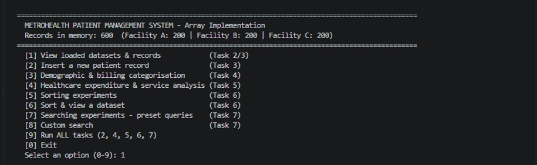
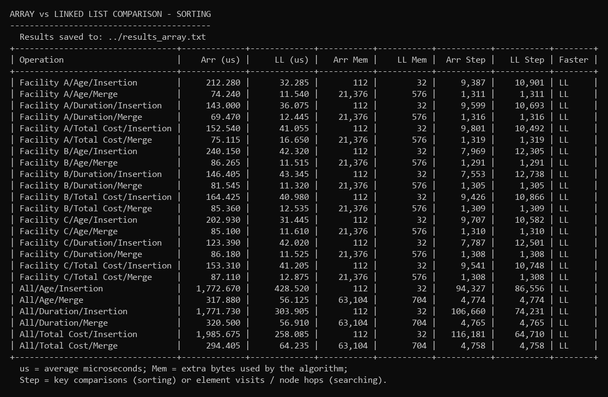
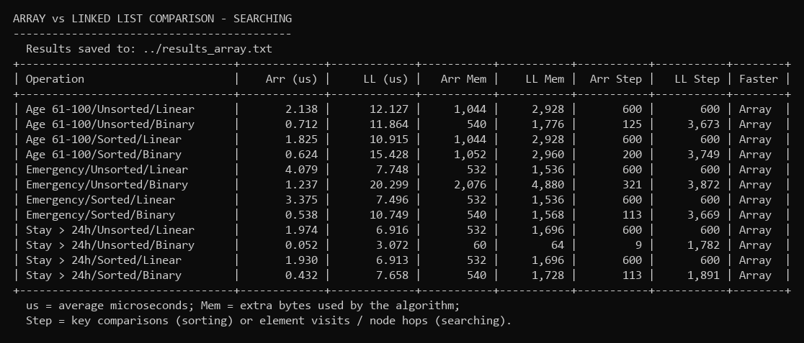
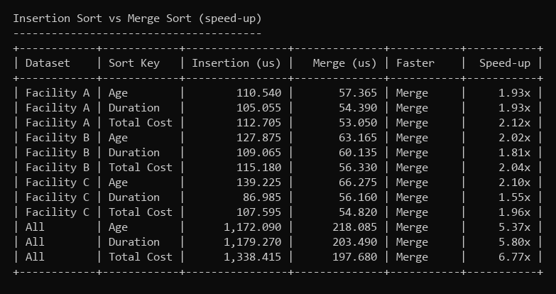
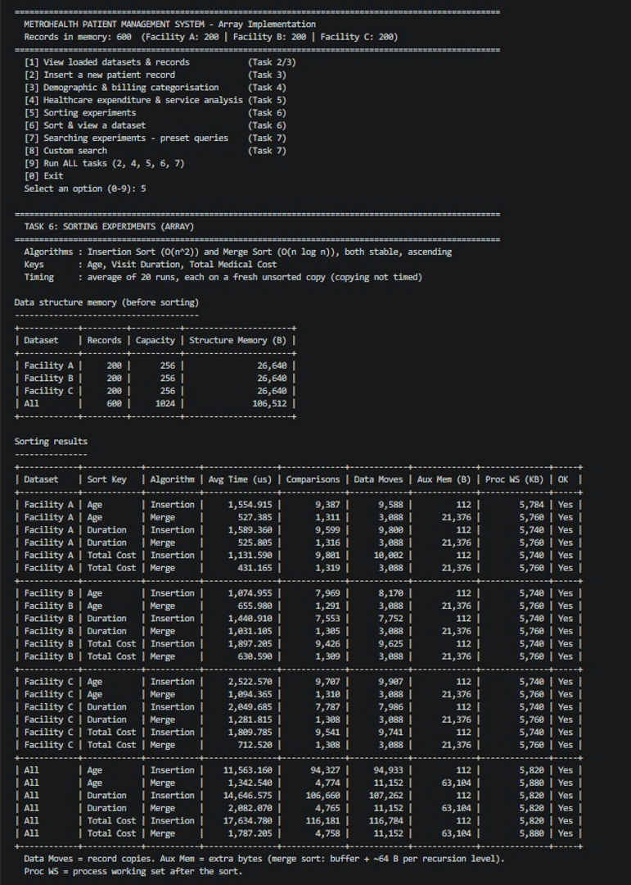
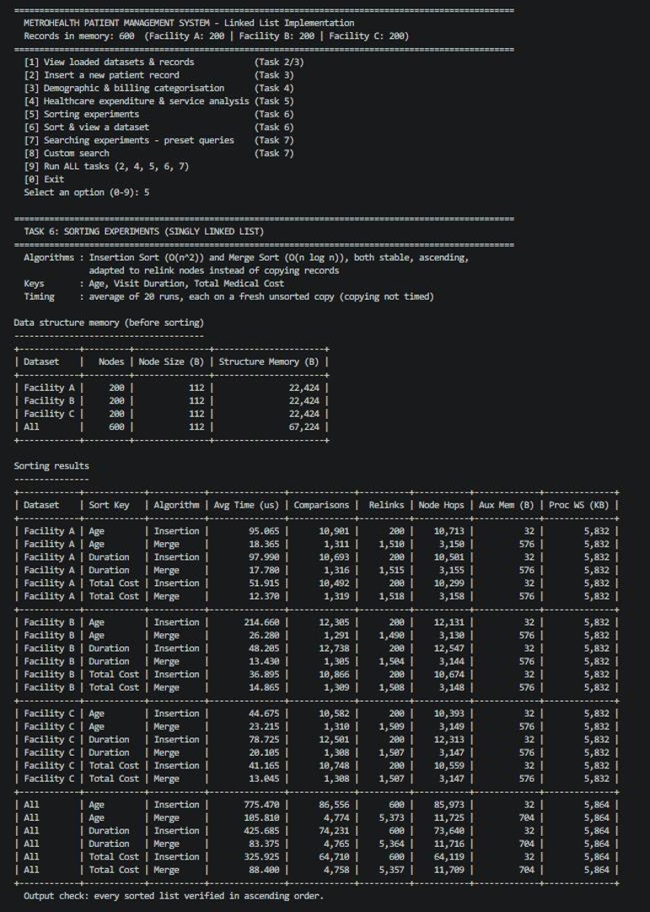
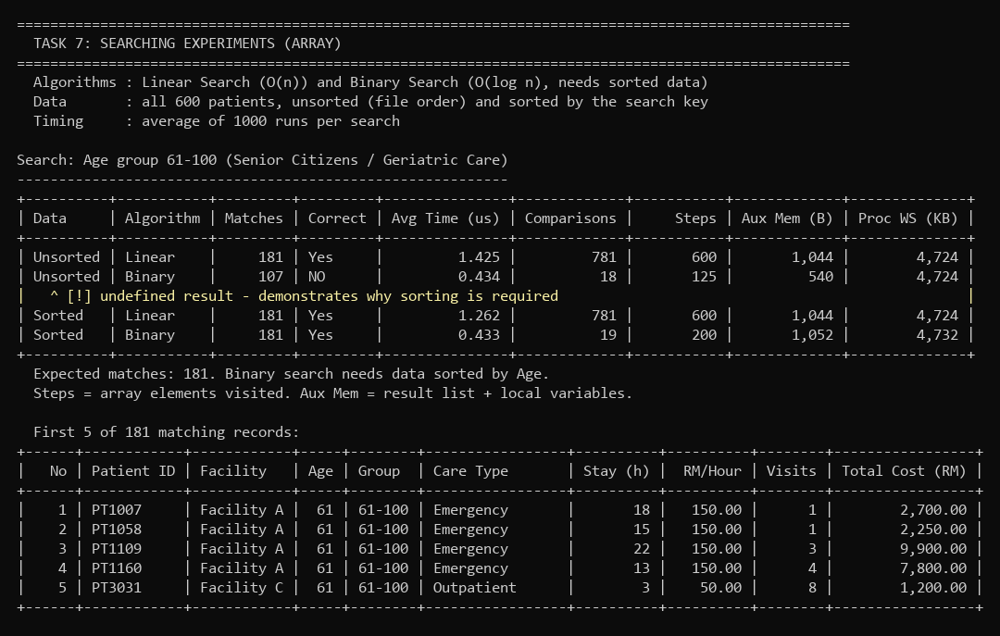
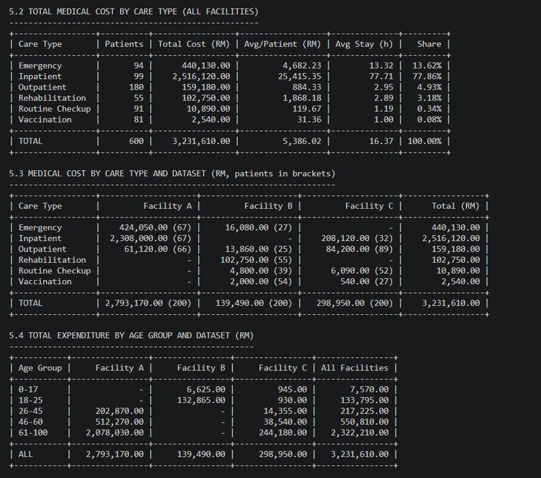

# MetroHealth Patient Management System — Array vs Linked List

A C++17 console application built to compare **custom Array** and **custom Singly Linked List** implementations for managing hospital patient records — including sorting, searching, categorisation, and healthcare-expenditure analysis.

This project was built for a Data Structures (DSTR) university module. It does **not** use any STL containers or algorithms (`std::vector`, `std::sort`, `std::map`, etc.) — every data structure and algorithm is hand-written from scratch to demonstrate low-level understanding of how they work.

> This was a group assignment; this repository documents the implementation work, benchmarking, and analysis I contributed (Merge Sort, Binary Search, Array vs. Linked List performance comparison, and report/results compilation).

## Scenario

MetroHealth operates three facilities (A, B, C), each with 200 patient records (600 total) containing:

- Age
- Care type (e.g. Inpatient, Outpatient, Vaccination, Rehabilitation, Emergency)
- Length of stay
- Base cost per hour
- Visits/days per year

The system loads all three datasets, merges them, lets the user categorise patients by age group, analyse healthcare costs, and run sorting/searching experiments — comparing the two underlying data structures on correctness, execution time, comparisons, and memory use.



## Features

| Module | Array Version | Linked List Version |
|---|---|---|
| Data loading from CSV | ✅ | ✅ |
| Insert new patient record | ✅ | ✅ |
| Age-group demographic analysis | ✅ | ✅ |
| Healthcare expenditure/cost analysis | ✅ | ✅ |
| **Sorting**: Insertion Sort & Merge Sort (by Age / Length of Stay / Cost) | ✅ | ✅ |
| **Searching**: Linear Search & Binary Search (by age range, care type, stay duration) | ✅ | ✅ |
| Performance logging (time, memory, comparisons, moves/relinks) | ✅ | ✅ |

Both programs expose the same menu-driven workflow and save their results to file, so the two structures can be benchmarked side by side.

## Results

All tests: 600 patient records, Release build, each sort averaged over 20 runs and each search over 1,000 runs.

### Sorting — Array vs Linked List (microseconds)

| Operation | Array (µs) | Linked List (µs) | Faster |
|---|---|---|---|
| Insertion Sort — Age | 1,772.67 | 428.52 | Linked List |
| Insertion Sort — Duration | 1,771.73 | 303.91 | Linked List |
| Insertion Sort — Total Cost | 1,985.68 | 258.09 | Linked List |
| Merge Sort — Age | 317.88 | 56.13 | Linked List |
| Merge Sort — Duration | 320.50 | 56.91 | Linked List |
| Merge Sort — Total Cost | 294.41 | 64.24 | Linked List |



**Why the Linked List wins at sorting:** both algorithms make the same number of *comparisons* on either structure, but the array has to physically **copy whole records** on every move (112 bytes each), while the linked list only has to **re-link a pointer** (8 bytes). Merge Sort was 5–7× faster than Insertion Sort on both structures, since it needs ~4,770 comparisons instead of 64,000–116,000.

### Searching — Array vs Linked List (microseconds)

| Query | Array — Linear | Array — Binary | LL — Linear | LL — Binary | Faster |
|---|---|---|---|---|---|
| Age 61–100 (sorted) | 1.825 | 0.624 | 10.915 | 15.428 | Array |
| Emergency care (sorted) | 3.375 | 0.538 | 7.496 | 10.749 | Array |
| Stay > 24h (sorted) | 1.930 | 0.432 | 6.913 | 7.658 | Array |



**Why the Array wins at searching:** the array can jump straight to any index in O(1), so Binary Search's O(log n) comparisons translate into real speed (3–6× faster than Linear Search). On the linked list, reaching the middle element still requires walking node-by-node (O(n)), so Binary Search ends up **slower** than Linear Search there, even though it makes fewer comparisons. Binary Search also correctly refuses to trust unsorted data — a `[!]` warning is shown and results come back wrong (e.g. 107 instead of 181 matches) if it's run on unsorted input.

### Insertion Sort vs Merge Sort



### Sample program output

<details>
<summary>Insertion Sort — Array implementation</summary>


</details>

<details>
<summary>Insertion Sort — Linked List implementation</summary>


</details>

<details>
<summary>Binary Search on sorted data</summary>


</details>

<details>
<summary>Healthcare expenditure & service analysis</summary>


</details>

## Clinical Insights

- **Ages 61–100 are the highest-cost group**: RM 2,322,210 total (72% of all billing), averaging RM 12,829.89 per patient — mostly from Inpatient care.
- **Top 10% of patients by cost (60 people) account for 69% of all billing** — almost all elderly Inpatients at Facility A.
- **104 patients stayed over 24 hours and make up 80% of total billing** — a strong candidate for daily discharge-planning review.
- **Facility A alone makes up 86.43% of total billing** (RM 3,231,610), with the longest average stay (38.19 hours).

**Recommendation:** keeping patient records in a **linked list for frequent inserts/updates**, plus maintaining a **sorted array copy for fast lookups**, would combine the strengths of both structures for a real hospital system.

## Project Structure

```
dstr-healthcare-data-structures/
├── Program_Array/             # Array-based implementation
│   ├── Program_Array.cpp      # Entry point / menu
│   ├── PatientArray.hpp       # Custom dynamic array container
│   ├── Records.hpp            # Patient record definition
│   ├── DataLoader.hpp         # CSV loading
│   ├── Demographics.hpp       # Age-group categorisation
│   ├── Expenditure.hpp        # Cost/billing analysis
│   ├── Sorting.hpp            # Insertion Sort + Merge Sort
│   ├── Searching.hpp          # Linear Search + Binary Search
│   ├── ResultLog.hpp          # Experiment result logging
│   └── CareTally.hpp / Table.hpp / Utils.hpp / Common.hpp
│
├── Program_LinkedList/         # Singly Linked List implementation (mirrors Program_Array)
│   ├── Program_LinkedList.cpp
│   ├── PatientList.hpp        # Custom singly linked list container
│   └── ... (same module set as above)
│
├── assets/screenshots/        # Program output screenshots (used above)
├── dataset1 facility_a.csv
├── dataset2 facility_b.csv
└── dataset3_facility_c.csv
```

## Building & Running

Both programs are standard C++17 console applications with no external dependencies.

**Visual Studio**
1. Create a new empty C++17 Console App project.
2. Add all `.hpp`/`.cpp` files from either `Program_Array/` or `Program_LinkedList/` to the project.
3. Place the three CSV dataset files in the same folder as the built executable (or a parent folder — the program searches automatically).
4. Build and run.

**g++ (Linux/macOS/WSL)**
```bash
cd Program_Array
g++ -std=c++17 -O2 Program_Array.cpp -o patient_array
./patient_array

cd ../Program_LinkedList
g++ -std=c++17 -O2 Program_LinkedList.cpp -o patient_linkedlist
./patient_linkedlist
```

## Complexity Summary

| Operation | Array | Linked List |
|---|---|---|
| Insert at end | O(1) average | O(1) with tail pointer |
| Access by position | O(1) | O(n) |
| Insertion Sort | O(n²), O(n) best case | O(n²) always |
| Merge Sort — time | O(n log n) | O(n log n) |
| Merge Sort — extra memory | O(n) | O(log n) |
| Linear Search | O(n) | O(n) |
| Binary Search — comparisons | O(log n) | O(log n) |
| Binary Search — time | O(log n) | O(n) (pointer-walk to reach the middle) |

## What I learned / demonstrated

- Implementing a dynamic array and a singly linked list from scratch (manual memory management, pointer-based traversal, resizing logic)
- Implementing and benchmarking two sorting algorithms (Insertion Sort — O(n²), Merge Sort — O(n log n)) across both structures
- Implementing and benchmarking two searching algorithms (Linear Search — O(n), Binary Search — O(log n), requiring sorted data) — including handling and flagging incorrect results on unsorted data
- Measuring and reasoning about real performance differences between array (contiguous, random-access) and linked list (pointer-chasing, sequential-access) structures
- Translating raw healthcare data into structured clinical insights (age-group cost breakdown, care-type usage patterns, discharge-planning recommendations)

## License

Shared for educational/portfolio purposes.
